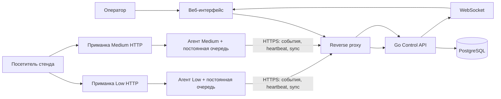

# HoneyForge

HoneyForge — проект централизованного управления honeypot-ловушками для специалистов по защите и центров мониторинга безопасности (SOC). Оператор создаёт профили приманок, назначает их экземплярам, следит за состоянием узлов и изучает последовательности действий посетителей в едином интерфейсе.

Главный сценарий проекта: оператор настраивает ловушку → посетитель взаимодействует с ней → агент надёжно доставляет событие в центр → оператор видит событие и связанную сессию. HoneyForge предназначен для контролируемой лабораторной демонстрации. Трафик и данные для демо должны быть синтетическими или поступать с собственных стендов.

## Статус проекта

В репозитории сохранён **локальный прототип** (`go run .`) и развивается отдельная система централизованного управления (`go run ./cmd/control`). Базовые части BE-01–03 уже находятся в `dev`; BE-04 включает API наблюдения, WebSocket, GeoIP, защищённый Compose центра и operator-only генератор deployment bundle. Приёмка FE2-01 с настоящим ZIP/установщиком на отдельном контейнерном Linux-узле описана в [docs/FE201_ACCEPTANCE.md](docs/FE201_ACCEPTANCE.md). Runtime Low/Medium и серверные шаблоны архива интегрированы; приёмка BE-03 описана в docs/BE03_ACCEPTANCE.md.

| Возможность | Состояние |
|---|---|
| Запуск локального Go-сервера | Реализовано |
| Фиктивный HTTP-архив | Реализовано |
| Панель с обновлением событий | Реализовано |
| Журнал последних 100 обращений в памяти | Реализовано; очищается при перезапуске |
| Контракты Low/Medium, HTTP-службы, фиктивная файловая система, журналирование и параметры канала | Реализованы в управляющем API и runtime приманки |
| PostgreSQL, миграции и сохранение профилей, истории и аудита | Реализовано в управляющем API |
| Вход, серверные сессии, роли `operator`/`viewer`, CSRF-защита | Реализовано в управляющем API |
| Создание, чтение, изменение и удаление профилей; неизменяемые ревизии и проверка `base_revision` | Реализовано в управляющем API |
| Конструктор и жизненный цикл профилей в UI | Реализованы и проверены; [приёмка FE1-01/02/03](docs/FE101_103_ACCEPTANCE.md) |
| Реестр ловушек, желаемая и применённая версии, выбор ревизии | Реализовано; назначение не выдаётся за применение |
| Одноразовая регистрация и credentials агента | Добавлены регистрация и чтение назначенной конфигурации |
| Очередь команд `start`/`stop`/`apply_profile` | Доставка, исполнение и подтверждение статуса реализованы агентом и decoy |
| Приём событий и сессий от агентов | Реализованы с устойчивой очередью агента и хранением в PostgreSQL |
| WebSocket, история, сводка и CSV | Реализованы в управляющем API; UI парка доступен в web/, полная приёмка остальных FE-задач отдельно |
| Low/Medium runtime | Реализованы с рабочими серверными страницами архива; приёмка описана в docs/BE03_ACCEPTANCE.md |
| TLS Compose центра и генератор bundle | Реализованы; UI → ZIP → install.sh → Docker Compose проверены на отдельном Linux-узле; production firewall остаётся QA-03 |

Перечисленные будущие возможности не следует считать реализованными или проверенными. Целевые метрики и сроки из проектного плана являются внутренними ориентирами, пока они не подтверждены решением команды и измерениями.

## Целевая система

HoneyForge проектируется как небольшой модульный центр, отдельные процессы агента и приманки, а также веб-интерфейс оператора. Один экземпляр ловушки получает профиль и состоит из сервиса-приманки и агента. Агент инициирует исходящее соединение к центру, получает конфигурацию и команды, отправляет события.



Планируемые сетевые контуры разделяют приманки, управляющие соединения агентов и внутренние службы центра. PostgreSQL не публикуется в атакуемую сеть. Управляющее API разделяет учётные данные оператора и агента. Bundle содержит отдельные процессы/контейнеры агента и приманки и разделённые сети; изоляцию на конкретном узле требуется подтвердить проверкой deployment. Локальный Compose публикует порты только на loopback-интерфейсе.

### Уровни взаимодействия

- **Low** — простая статическая HTTP-приманка. Она фиксирует обращения, но не предоставляет успешный вход или настоящую файловую систему.
- **Medium** — ограниченная HTTP-панель с синтетическими учётными данными, отдельными сессиями и фиктивными файлами. Действия посетителя должны связываться в последовательность событий.

Оба уровня эмулируют сервисы и не исполняют команды посетителя на хосте. Поддержка дополнительных протоколов и более высокой интерактивности не входит в базовый объём без отдельного решения.

### Основные части целевой системы

- **Control API** — авторизация и роли, профили и их версии, учёт ловушек, команды, события и аудит.
- **Агент** — регистрация конкретного экземпляра, периодическая проверка связи, получение конфигурации, ограниченного набора команд и доставка событий.
- **Приманка** — изолированный сервис Low или Medium, который создаёт события при действиях посетителя.
- **Веб-интерфейс** — обзор состояния, список ловушек, редактор профилей, фильтруемая лента событий и хронология сессий.
- **Хранилища** — PostgreSQL в центре и постоянная локальная очередь на узле агента.

## План развития

1. **Локальный прототип — сохранён.** HTTP-архив, панель и ограниченный журнал в памяти остаются в корневом `main.go`.
2. **Основа системы — реализована (BE-01).** Версионированные контракты, PostgreSQL, роли и сессии, профили, ловушки, регистрация агентов и очередь команд.
3. **Агент и доставка — реализованы (BE-02).** Агент поддерживает регистрацию, heartbeat, команды с постоянным журналом результатов и устойчивую очередь событий. Сценарии разрыва, рестарта, потери ACK и диагностика описаны в [приёмке BE-02](docs/BE02_ACCEPTANCE.md).
4. **Приманки Low/Medium — реализованы (BE-03).** Runtime и IPC из PR #23 дополнены рабочими серверными шаблонами лаборатории. Процессные и PostgreSQL-проверки описаны в [приёмке BE-03](docs/BE03_ACCEPTANCE.md).
5. **Наблюдение и защищённый центр — реализуются (BE-04).** История, timeline, сводка, CSV, WebSocket, GeoIP, TLS Compose и operator-only remote bundle готовы; парк FE2-01 и запуск bundle проверены на контейнерном Linux-узле; production-размещение центра и firewall проверяются отдельно.
6. **Полная production-приёмка — впереди.** После контейнерного bundle-прогона FE2-01 остаются целевые хосты, firewall/атакуемый сегмент, нагрузка и общая проверка восстановления системы.

Базовые CSV и комплект развёртывания реализованы. Дополнительные правила оповещения и удалённый запуск одной кнопкой рассматриваются после прохождения обязательного сквозного сценария. Универсальное удалённое выполнение команд, Docker socket в центре, Kubernetes, полноценный SIEM, приманки с высоким уровнем взаимодействия и анализ данных посетителей языковой моделью не входят в базовую версию.

## Запуск текущего прототипа

Старый прототип изначально был написан для Go 1.22, но общий `go.mod` задаёт минимум Go 1.26 для управляющего API и его зависимостей. Для запуска любой команды из этого рабочего дерева нужна Go 1.26 или новее; проверка выполнялась на Go 1.27.2.

```sh
go run .
```

По умолчанию сервер доступен только локально:

- Приманка: <http://127.0.0.1:8080/>
- Панель: <http://127.0.0.1:8080/dashboard>
- API журнала: <http://127.0.0.1:8080/api/events>

Остановить сервер можно через `Ctrl+C`. Чтобы выбрать другой адрес и порт:

```sh
go run . -addr 127.0.0.1:8081
```

Панель не требует входа. Не публикуйте этот прототип в интернете; при локальной демонстрации оставляйте его привязанным к loopback-интерфейсу.

## Операторский интерфейс

Парк ловушек находится в `web/`. Установка, настройки Origin и браузерные проверки:
[web/README.md](web/README.md). По умолчанию интерфейс использует настоящий API.
Конструктор, жизненный цикл профилей и API-клиент проверены совместно;
[приёмка FE1-01/02/03](docs/FE101_103_ACCEPTANCE.md) содержит сценарии и ограничения.

## Control API

Управляющее API слушает `127.0.0.1:8081`, требует `DATABASE_URL` и при старте применяет версионированные транзакционные миграции, не очищая данные. Возьмите `.env.example` за основу локальных настроек, задайте случайный пароль PostgreSQL, совместимый с URI, и установите переменные в PowerShell:

```powershell
$env:DATABASE_URL = 'postgres://honeyforge:<ваш-пароль>@127.0.0.1:5432/honeyforge?sslmode=disable'
$env:PUBLIC_ORIGIN = 'http://127.0.0.1:8081'
$env:COOKIE_SECURE = 'false' # только локальный HTTP на loopback
go run ./cmd/control -create-user # создаёт оператора; пароль не отображается при вводе
go run ./cmd/control
```

Программа создания пользователя принимает `HF_USERNAME`, `HF_ROLE` и `HF_PASSWORD` из переменных окружения либо запрашивает недостающие значения. По умолчанию при интерактивном запуске выбирается роль `operator`. Пароль должен содержать от 12 до 72 байт. Сервер не создаёт стандартную учётную запись и не сбрасывает пароль существующего пользователя.

Локальный стенд Docker Compose запускает PostgreSQL 17 и управляющее API с постоянным томом данных. Оба опубликованных порта доступны только через loopback-интерфейс:

```powershell
Copy-Item .env.example .env
# Замените POSTGRES_PASSWORD своим случайным паролем, совместимым с URI.
docker compose up --build
```

API предоставляет `/healthz`, `/readyz`, `/api/v1` для оператора и `/agent/v1` для агента. Сессионная cookie имеет атрибуты `HttpOnly` и `SameSite=Lax` и действует восемь часов. Изменяющие запросы требуют CSRF-cookie и совпадающего заголовка `X-CSRF-Token`. История и поиск событий доступны через `/api/v1/events`, сессионная хронология — через `/api/v1/sessions/{id}/timeline`, сводка — через `/api/v1/events/summary`, CSV — через `/api/v1/events/export.csv`. Обычные ответы не содержат payload события; его чтение оператором записывается в аудит. Для рабочего размещения используйте TLS-фасад из [deploy/compose.yaml](deploy/compose.yaml) и инструкции [BE-04 foundation](docs/BE04_FOUNDATION.md).

Полный контракт и примеры описаны в [api/openapi.yaml](api/openapi.yaml); отдельные JSON-файлы находятся в [examples](examples). Приём и чтение событий работают; `/api/v1/ws` передаёт авторизованным клиентам уведомления о сохранённых изменениях. Центр безопасного Compose размещения и текущие ограничения BE-04 описаны в [BE-04 foundation](docs/BE04_FOUNDATION.md). Операторский UI в [web/](web/README.md) использует `/api/v1`; парк, enrollment и запуск скачанного bundle проверены с настоящими агентами и Docker Compose. Остальные FE-задачи и production-приёмка остаются отдельными.

Контрактные и API-проверки QA-01 для профилей, ролей, ревизий и регистрации
запускаются одной командой из [docs/QA01_ACCEPTANCE.md](docs/QA01_ACCEPTANCE.md):
`./scripts/test-qa01.ps1` с `TEST_DATABASE_URL`, указывающей на отдельную
тестовую базу.

## Что готово в текущем прототипе

- `main.go` запускает HTTP-сервер, встраивает HTML-страницы и хранит последние 100 событий в потокобезопасном журнале.
- `archive.html` — фиктивный архив. Пути приманки возвращают одну демонстрационную страницу; настоящих файлов, входа и сессий нет.
- `dashboard.html` отображает события и запрашивает обновления API каждые две секунды.
- Событие содержит `time` в UTC, IP сетевого соединения, HTTP-метод и путь запроса. Новые события выдаются первыми.
- Маршруты `/dashboard` и `/dashboard/` обслуживают панель. `/api/events` выдаёт журнал и не записывается как обращение к приманке; остальные маршруты `/api/` зарезервированы. Остальные пути попадают в журнал приманки.
- Query-параметры, тела запросов и заголовки не сохраняются. IP берётся из соединения; proxy-заголовки не используются.
- Журнал хранится только в памяти процесса и очищается после перезапуска. Аутентификации и постоянного хранения нет.

## Проверка текущей версии

Сборка и статические проверки:

```sh
go build ./...
go vet ./...
go test ./...
```

Интеграционный тест PostgreSQL пропускается с пояснением, если не задана переменная `TEST_DATABASE_URL`. Тест создаёт в указанной базе отдельную схему со случайным именем и по завершении удаляет только её:

```powershell
$env:TEST_DATABASE_URL = 'postgres://<test-user>:<test-password>@127.0.0.1:5432/<test-database>?sslmode=disable'
go test -race -count=1 -v ./...
```

Не указывайте адрес рабочей или пользовательской базы. Для ручной проверки сохранённого прототипа:

1. Запустите сервер и откройте `/dashboard`: список событий пуст.
2. Откройте `/`, затем `/reports` в том же браузере.
3. Вернитесь на панель. Должны появиться два события с временем, IP, методом и путём.
4. Обновите панель и запросите `/api/events`: эти действия не должны добавиться в журнал.
5. Убедитесь, что новые события идут первыми. После более чем 100 обращений в журнале остаются последние 100.
6. Перезапустите сервер: журнал должен очиститься.

Для PowerShell можно создать событие и прочитать API:

```powershell
Invoke-WebRequest http://127.0.0.1:8080/demo
Invoke-RestMethod http://127.0.0.1:8080/api/events
```

После изменения `archive.html` или `dashboard.html` перезапустите сервер: страницы встраиваются в приложение при сборке.

## Данные и безопасность

Текущий прототип принимает обращения на loopback и записывает только четыре поля события: время, IP, метод и путь. Журнал ограничен 100 записями и не переживает перезапуск. Панель доступна без входа, поэтому безопасный сценарий текущей версии — локальный запуск.

В управляющей системе данные посетителей считаются недоверенными, а интерфейс отображает их как текст. Агент использует отдельные учётные данные и проверяет TLS; API оператора и агента разделены, права проверяет сервер. Агент подтверждает локальную запись события до ответа приманки и хранит его до подтверждения центра. Повторная отправка не создаёт копию: центр устраняет дубли по `(agent_id,event_id)`. Сетевую изоляцию deployment bundle нужно подтвердить проверкой сервисов из атакуемого сегмента.

Сессии, роли, CSRF-защита, разделение маршрутов и аудит реализованы в управляющем API задачи #1; агент и очередь — в #2; runtime Low/Medium — в #3. Парк FE2-01 и запуск bundle проверены на отдельном контейнерном Linux-узле, включая запрет исходящего подключения decoy к центру. Полная приёмка остальных экранов и firewall физического/удалённого production-хоста остаётся отдельной.

## Структура репозитория сейчас

```text
.
├── main.go                    # Сохранённый прототип: страницы и журнал в памяти
├── cmd/control                # Управляющее API и командная утилита
├── internal/contracts         # Структуры данных и проверки API
├── internal/control           # HTTP API и PostgreSQL-операции
├── migrations                 # Встроенные транзакционные SQL-миграции
├── api/openapi.yaml           # Контракт операторского, агентского и event API
├── examples                  # Примеры профилей, событий, команд и WS-уведомлений
├── compose.yaml               # Локальный стенд PostgreSQL/API на loopback
└── README.md                  # Статус, запуск и пределы готовности
```

Подробное объяснение текущей реализации и словарь терминов находятся в [docs/WORK_STATUS_AND_GLOSSARY.md](docs/WORK_STATUS_AND_GLOSSARY.md), а описание папок и устройства Go-проекта — в [docs/PROJECT_STRUCTURE.md](docs/PROJECT_STRUCTURE.md). План и матрица проверки BE-01 доступны в [docs/BE01_PLAN.md](docs/BE01_PLAN.md) и [docs/BE01_ACCEPTANCE.md](docs/BE01_ACCEPTANCE.md).
