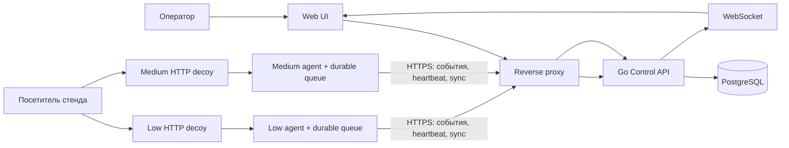

# HoneyForge

HoneyForge — проект централизованного управления honeypot-ловушками для Blue Team и SOC. Оператор должен создавать профили приманок, назначать их экземплярам, видеть состояние узлов и изучать последовательности действий посетителей в едином интерфейсе.

Главный сценарий проекта: оператор настраивает ловушку → посетитель взаимодействует с ней → агент надёжно доставляет событие в центр → оператор видит событие и связанную сессию. HoneyForge предназначен для контролируемой лабораторной демонстрации. Трафик и данные для демо должны быть синтетическими или поступать с собственных стендов.

## Статус проекта

В репозитории сейчас работает **локальный прототип**, а не целевая распределённая система. Прототип показывает HTTP-приманку, панель и временный журнал событий в одном Go-процессе.

| Возможность | Состояние |
|---|---|
| Запуск локального Go-сервера | Реализовано |
| Фиктивный HTTP-архив | Реализовано |
| Панель с обновлением событий | Реализовано |
| Журнал последних 100 обращений в памяти | Реализовано; очищается при перезапуске |
| Управление профилями Low/Medium из центра | Запланировано |
| Регистрация отдельных агентов и ловушек | Запланировано |
| PostgreSQL, постоянная очередь и повторная доставка | Запланировано |
| Авторизация оператора и роли | Запланировано |
| Команды центра и применение конфигурации агентом | Запланировано |
| Реальное поведение Medium с сессиями и fake filesystem | Запланировано |
| TLS-контур агента, изоляция сетей и аудит | Запланировано |

Перечисленные будущие возможности не следует считать реализованными или проверенными. Целевые метрики и сроки из проектного плана являются внутренними ориентирами, пока они не подтверждены решением команды и измерениями.

## Целевая система

HoneyForge проектируется как небольшой модульный центр, отдельные процессы агента и приманки, а также веб-интерфейс оператора. Один экземпляр ловушки получает профиль и состоит из сервиса-приманки и агента. Агент инициирует исходящее соединение к центру, получает конфигурацию и команды, отправляет события.



Планируемые сетевые контуры разделяют атакуемые приманки, management-соединения агентов и внутренние сервисы центра. PostgreSQL не публикуется в атакуемую сеть. Управляющие токены и файлы конфигурации агента недоступны посетителю приманки. Эта схема описывает цель проекта; текущий прототип таких компонентов и границ не реализует.

### Уровни взаимодействия

- **Low** — простая статическая HTTP-приманка. Она фиксирует обращение, но не предоставляет успешный вход или реальную файловую систему.
- **Medium** — ограниченная HTTP-админка с синтетическими учётными данными, отдельными сессиями и фиктивными файлами. Поведение должно быть связано в одну наблюдаемую последовательность событий.

Оба уровня эмулируют сервисы и не исполняют команды посетителя на хосте. Поддержка дополнительных протоколов и более высокой интерактивности не входит в базовый объём без отдельного решения.

### Основные части целевой системы

- **Control API** — авторизация и роли, профили и их версии, учёт ловушек, команды, события и аудит.
- **Agent** — регистрация конкретного экземпляра, heartbeat, получение конфигурации, ограниченный набор команд и доставка событий.
- **Decoy** — изолированный сервис Low или Medium, который создаёт события из действий посетителя.
- **Web UI** — обзор состояния, список ловушек, редактор профилей, фильтруемая лента событий и timeline сессии.
- **Хранилища** — PostgreSQL в центре и постоянная локальная очередь на узле агента.

## План развития

1. **Локальный прототип — готово частично.** HTTP-архив, панель, API событий и ограниченный журнал в памяти. Это текущая версия репозитория.
2. **Основа системы — впереди.** Зафиксировать версии контрактов Event/Profile/Trap, структуру приложения, конфигурацию окружения, миграции и воспроизводимый локальный стенд.
3. **Первый сквозной путь — впереди.** Реальный запрос к Low проходит через локальную постоянную очередь и появляется в центре и UI.
4. **Управление — впереди.** Добавить вход и серверные роли, CRUD версий профилей, регистрацию ловушек, heartbeat, конфигурацию и безопасные команды.
5. **Medium и рабочий интерфейс — впереди.** Реализовать сессии и fake filesystem, фильтры, детали событий и восстановление UI после потери WebSocket-соединения.
6. **Надёжность и приёмка — впереди.** Проверить повторную доставку без потерь и дублей, рестарты, TLS, сетевую изоляцию, лимиты, запуск на чистой машине и все обязательные сценарии.

Бонусы вроде CSV, простых правил оповещения и ограниченного deployment bundle рассматриваются только после прохождения обязательного сквозного сценария. Универсальное удалённое выполнение команд, Docker socket в центре, Kubernetes, полноценный SIEM, High interaction и LLM-анализ посетительских данных не входят в базовую версию.

## Запуск текущего прототипа

Нужен Go 1.22 или новее. Внешние пакеты и frontend-сборка для текущей версии не требуются.

```sh
go run .
```

По умолчанию сервер доступен только локально:

- Приманка: <http://127.0.0.1:8080/>
- Панель: <http://127.0.0.1:8080/dashboard>
- API журнала: <http://127.0.0.1:8080/api/events>

Остановить сервер можно через `Ctrl+C`. Чтобы выбрать другой адрес и порт:

```sh
go run . -addr 127.0.0.1:8081
```

Панель не имеет авторизации. Не выставляйте этот прототип в публичную сеть; сохраняйте loopback-привязку при локальной демонстрации.

## Что готово в текущем прототипе

- `main.go` запускает HTTP-сервер, встраивает HTML-страницы и хранит последние 100 событий в потокобезопасном журнале.
- `archive.html` — фиктивный архив. Пути приманки возвращают одну демонстрационную страницу; настоящих файлов, входа и сессий нет.
- `dashboard.html` отображает события и опрашивает API каждые две секунды.
- Событие содержит `time` в UTC, IP сетевого соединения, HTTP-метод и путь запроса. Новые события выдаются первыми.
- Маршруты `/dashboard` и `/dashboard/` обслуживают панель. `/api/events` выдаёт журнал и не записывается как обращение к приманке; остальные маршруты `/api/` зарезервированы. Остальные пути попадают в журнал приманки.
- Query-параметры, тела запросов и заголовки не сохраняются. IP берётся из соединения; proxy-заголовки не используются.
- Журнал хранится только в памяти процесса и очищается после перезапуска. Аутентификации и постоянного хранения нет.

## Проверка текущей версии

Сборка и статические проверки:

```sh
gofmt -d main.go
go build ./...
go vet ./...
```

Автоматизированных тестов пока нет. Для ручной проверки:

1. Запустите сервер и откройте `/dashboard`: список событий пуст.
2. Откройте `/`, затем `/reports` в том же браузере.
3. Вернитесь на панель. Должны появиться два события с временем, IP, методом и путём.
4. Обновите панель и запросите `/api/events`: эти действия не должны добавиться в журнал.
5. Убедитесь, что новые события идут первыми. После более чем 100 обращений в журнале остаются последние 100.
6. Перезапустите сервер: журнал должен очиститься.

Для PowerShell можно создать событие и прочитать API:

```powershell
Invoke-WebRequest http://127.0.0.1:8080/demo
Invoke-RestMethod http://127.0.0.1:8080/api/events
```

После изменения `archive.html` или `dashboard.html` перезапустите сервер: страницы встраиваются в приложение при сборке.

## Данные и безопасность

Текущий прототип принимает обращения на loopback и записывает только четыре поля события: время, IP, метод и путь. Журнал ограничен 100 записями и не переживает перезапуск. Панель доступна без входа, поэтому безопасный сценарий текущей версии — локальный запуск.

В целевой системе посетительские данные считаются недоверенными. UI показывает их как текст. Агенты используют отдельные credentials и проверяют TLS; операторские и агентские API разделены; права проверяет сервер. Локальное событие остаётся в очереди до подтверждения центром после записи. Повторная доставка должна быть идемпотентной и дедуплицироваться по `event_id`. Сетевую изоляцию подтверждают проверкой доступности из атакуемого сегмента.

Эти целевые меры безопасности ещё предстоит реализовать и проверить; они не являются свойствами нынешнего прототипа.

## Структура репозитория сейчас

```text
.
├── main.go          # HTTP-сервер, маршруты и журнал в памяти
├── archive.html     # Страница фиктивного архива
├── dashboard.html   # Панель событий
├── go.mod           # Модуль honeyforge, Go 1.22
└── README.md        # Общее описание проекта, статус и запуск текущей версии
```

Подробный рабочий план команды хранится отдельно от Git. Этот README самодостаточно описывает продукт, целевое направление, готовность текущей версии и её запуск. Перечисленные целевые возможности не доказывают, что они реализованы; вклад в код должен сопровождаться описанием фактически доступного поведения и проверок.
