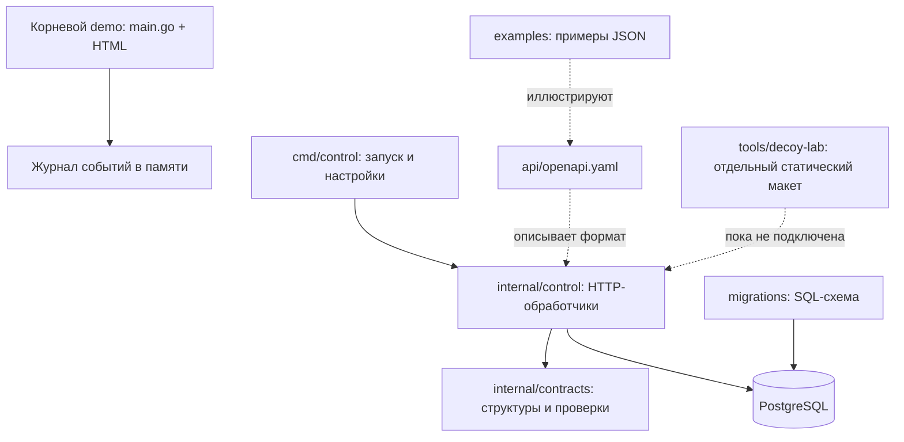
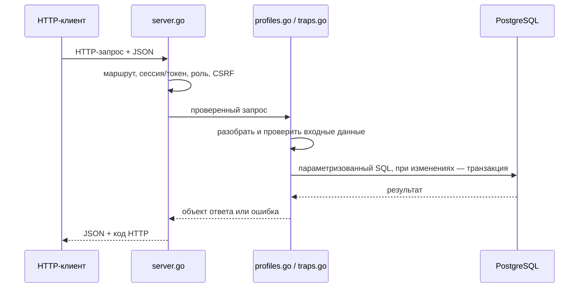

# Путеводитель по проекту HoneyForge

Здесь объяснено, что находится в папках и важных файлах HoneyForge, как части связаны друг с другом и как обычно строят серверное приложение на Go. Документ описывает фактическое дерево репозитория. Если в тексте говорится о будущей функции, она помечена как план, а не как уже работающий код.

## Как читать структуру проекта

У проекта сейчас есть три отдельные части:

1. **Старый демонстрационный сервер** в корне: `main.go`, `archive.html`, `dashboard.html`. Он запускается командой `go run .` и хранит небольшой журнал только в памяти.
2. **Управляющее API BE-01**: `cmd/control`, `internal`, `migrations`, `api`, `examples`. Оно запускается командой `go run ./cmd/control`, использует PostgreSQL и реализует профили, ловушки, доступ, регистрацию агента и запись команд в очередь.
3. **Лаборатория шаблонов приманок** в `tools/decoy-lab`. Это отдельная статическая веб-страница для редактирования и просмотра внешнего вида Low/Medium. Она не является рабочей приманкой, не обращается к API и не запускает серверные сессии.



## Дерево верхнего уровня

```text
HoneyForge/
├── api/                         описание HTTP API
├── cmd/control/                 запускаемый управляющий сервер
├── docs/                        планы, приёмка и объяснения проекта
├── examples/                    примеры запросов и будущих сообщений
├── internal/
│   ├── contracts/               типы данных и проверка настроек
│   └── control/                 HTTP-обработчики и PostgreSQL-логика
├── migrations/                  SQL-миграции и их запуск
├── tools/decoy-lab/             самостоятельная лаборатория шаблонов
├── .dockerignore                файлы, не отправляемые Docker-сборке
├── .env.example                 образец переменных окружения
├── .gitignore                   правила игнорирования Git
├── Dockerfile.control           сборка образа управляющего API
├── compose.yaml                 локальный набор PostgreSQL и API
├── go.mod                       имя модуля, версия Go и библиотеки
├── go.sum                       контрольные суммы версий библиотек
├── main.go                      старый демонстрационный сервер
├── archive.html                 страница старого демо
├── dashboard.html               панель событий старого демо
├── README.md                    описание, запуск и статус
└── HONEYFORGE_FULL_PLAN.md      локальный план проекта
```

`HONEYFORGE_FULL_PLAN.md` уже находится в рабочей папке и написан по-русски, но в текущую ветку он не включён. Его содержимое не является кодом приложения; при публикации ветки его нужно добавлять отдельно только по явному решению.

## Файлы и папки по назначению

### Корень репозитория

- **`go.mod`** объявляет имя Go-модуля `honeyforge`, минимальную версию Go и прямые зависимости. В этом проекте указана Go 1.26; сборка проверялась Go 1.27.2. Здесь Go берёт начало полных имён импортов вроде `honeyforge/internal/control`.
- **`go.sum`** фиксирует контрольные суммы скачанных версий библиотек. Он позволяет сборке проверять, что получен ожидаемый исходный пакет. Обычно его изменяет `go mod tidy` или `go get`, а не разработчик вручную.
- **`.env.example`** показывает, какие настройки нужны для локального запуска: адрес PostgreSQL, адрес HTTP-сервера, внешний адрес сайта, признак защищённой cookie. В нём только пример и заглушка для пароля, не рабочий секрет.
- **`.gitignore`** задаёт, какие локальные файлы Git не должен предлагать добавить. Это удобно для сборочных результатов, локальных настроек и персональных файлов.
- **`.dockerignore`** похож по смыслу, но действует только при передаче файлов в Docker-сборку. Например, в образ не нужно копировать `.git`, локальный `.env`, исполняемые файлы и локальный план.
- **`Dockerfile.control`** содержит шаги сборки исполняемого файла Control API и его запуска в контейнере.
- **`compose.yaml`** описывает локальные службы PostgreSQL и Control API, их настройки, проверку готовности и постоянный том базы. Это конфигурация окружения, а не Go-код.
- **`README.md`** — начальная документация: описание проекта, различие демо и Control API, команды запуска, текущее состояние и ссылки на более подробные документы.
- **`main.go`** — точка входа старого demo. Файл относится к корневому Go-пакету, а не к `cmd/control`.
- **`archive.html`** и **`dashboard.html`** — страницы старого demo. Они показывают статический архив и временный журнал; это не интерфейс новой базы профилей.
- **`HONEYFORGE_FULL_PLAN.md`** — локальный план требований. Он не входит в опубликованную ветку BE-01.

### `cmd/control/` — программа и её запуск

В [`cmd/control/main.go`](../cmd/control/main.go) находится `package main`. В Go именно такой пакет компилируется в самостоятельную программу. `main()` читает настройки из переменных окружения, проверяет URL базы, создаёт соединительный пул, проверяет доступность PostgreSQL, запускает миграции и после этого поднимает HTTP-сервер.

Там же находится флаг `-create-user`. Он создаёт оператора или зрителя с bcrypt-хешем пароля; по умолчанию пароль запрашивается без отображения символов. Такой отдельный путь нужен, чтобы не прошивать начальные пароли в исходный код или конфигурацию.

В типичном большом Go-проекте в `cmd/` лежит по папке на каждую запускаемую программу. Например, будущие `cmd/agent` и `cmd/decoy` должны быть отдельными приложениями с собственными `main.go`, а не большими условными ветками внутри Control API. Сейчас этих двух программ ещё нет.

### `internal/contracts/` — формат данных

В [`internal/contracts/types.go`](../internal/contracts/types.go) описаны Go-структуры, которые представляют данные API: профиль, версию профиля, службу, фиктивный файл, ловушку, агента, команду, событие, ошибку и страницу списка.

Теги наподобие ``json:"profile_id"`` говорят стандартному кодировщику Go, под каким именем поле попадёт в JSON. Например, поле Go `ProfileID` будет передаваться как `profile_id`. Так серверные структуры связываются с форматом, который ожидает клиент.

Здесь же проверяются ограничения конфигурации: допустимый уровень, HTTP-протокол, порты, длина текстов, категории журнала и безопасность относительных путей. Проверка вынесена в отдельный пакет, чтобы правила данных можно было тестировать независимо от HTTP и PostgreSQL.

Каталог `internal/` имеет особое значение для Go: пакет внутри него можно импортировать только из того же родительского модуля. Это способ обозначить внутреннюю реализацию, которой другие Go-модули пользоваться не должны. В HoneyForge `internal/contracts` и `internal/control` доступны приложению `honeyforge`, но не являются публичной библиотекой для посторонних проектов.

### `internal/control/` — HTTP и правила приложения

Этот пакет собирает управляющий сервер и реализует его сценарии.

- [`server.go`](../internal/control/server.go) создаёт маршрутизатор, связывает URL и HTTP-методы с обработчиками, проверяет вход и права, обрабатывает CSRF, формирует JSON и единый формат ошибок. Здесь же находятся общие функции для идентификатора запроса, разбора JSON и пагинации.
- [`profiles.go`](../internal/control/profiles.go) отвечает за список, создание, чтение, изменение, логическое удаление профилей и историю ревизий. Он также скрывает синтетические пароли в обычных ответах и отдельно обрабатывает разрешённое чтение чувствительной версии.
- [`traps.go`](../internal/control/traps.go) отвечает за экземпляры ловушек: создание и список, назначение/отвязку профиля, регистрацию агента, чтение конфигурации по токену агента и очередь команд.
- [`control_integration_test.go`](../internal/control/control_integration_test.go) проверяет HTTP API в связке с PostgreSQL. Интеграционный тест создаёт собственную случайную схему в выделенной тестовой базе и очищает только её.

Поток обычного запроса выглядит так:



Не каждый маршрут использует каждый этап: например, `/healthz` не требует входа, а `/readyz` проверяет базу. Агентские маршруты проверяют токен агента, а не cookie оператора. При изменениях профиля, назначении и командах соответствующее действие и запись аудита должны сохраняться согласованно.

### `migrations/` — устройство PostgreSQL

- **`001_init.sql`** создаёт таблицы, внешние ключи, ограничения допустимых статусов и индексы для поиска.
- **`migrate.go`** встраивает SQL-файлы в собранную Go-программу директивой `//go:embed`. При старте он сортирует их по имени, проверяет таблицу `schema_migrations` и применяет только ещё не выполненные файлы. Поэтому на сервере не нужно отдельно искать SQL-файлы рядом с исполняемым файлом.

Новую схему базы следует менять новым файлом, например `002_add_agent_heartbeat.sql`, а не редактированием уже применённого `001_init.sql`. Для обновления уже работающей базы миграция должна добавлять/изменять данные безопасно и отмечаться как выполненная. Тестам нельзя удалять базу, которой пользуется человек; текущая проверка изолирует изменения случайной схемой.

### `api/` — описание внешнего контракта

[`api/openapi.yaml`](../api/openapi.yaml) — OpenAPI-описание API. Оно перечисляет маршруты, методы, параметры, роли, форматы JSON, коды ошибок и схемы объектов. По нему фронтенд и будущий агент могут понять, как обращаться к серверу, не читая всю реализацию обработчиков.

В описании есть схемы будущих событий, сессий и WebSocket-уведомлений. Наличие схемы не означает наличия рабочего маршрута: текущий OpenAPI помечает будущие поверхности, а `internal/control/server.go` их не регистрирует.

### `examples/` — примеры сообщений

JSON-файлы показывают примеры допустимого профиля, ловушки и команды. Файлы с суффиксом **`.future.json`** иллюстрируют форматы событий, сессий и уведомлений следующих этапов. Их можно использовать при согласовании клиента, но сами по себе эти файлы ничего не отправляют и не проверяют.

Пример стоит изменять вместе со схемой OpenAPI и кодом, если формат API меняется. Тогда документация, сервер и клиент не расходятся по именам полей и обязательным значениям.

### `docs/` — документация разработки

- [`WORK_STATUS_AND_GLOSSARY.md`](WORK_STATUS_AND_GLOSSARY.md) рассказывает о выполненной работе и терминах.
- [`BE01_PLAN.md`](BE01_PLAN.md) фиксирует план и границы BE-01.
- [`BE01_ACCEPTANCE.md`](BE01_ACCEPTANCE.md) фиксирует критерии, проверки и известные ограничения.
- [`PROJECT_STRUCTURE.md`](PROJECT_STRUCTURE.md) — этот путеводитель по репозиторию и устройству Go-проекта.

### `tools/decoy-lab/` — отдельная лаборатория макетов

Эта часть попала в `dev` отдельной задачей и существует рядом с сервером, но не является дочерним Go-пакетом: внутри неё HTML, CSS и JavaScript. Она запускается отдельным статическим HTTP-сервером и может работать без Go и PostgreSQL.

- **`index.html`**, **`lab.css`**, **`lab.js`** — экран лаборатории, его стили и управляющая логика.
- **`templates/preview.html`** — изолированная область предпросмотра. **`shared.js`**, **`low.js`**, **`medium.js`** формируют представления Low и Medium.
- **`fixtures/example.js`** создаёт начальные синтетические данные для редактирования. **`fixtures/documents/`** хранит соответствующие текстовые образцы.
- **`assets/archive.css`** содержит стили макетов. **`assets/screenshots/`** и **`assets/review-fixes/`** содержат снимки экранов и материалы проверки внешнего вида; файлы `QA.md`, `verification.json` и `visual-diff.json` фиксируют результаты и замечания.
- **`README.md`** объясняет локальный запуск лаборатории, а **`INTEGRATION.md`** описывает, как впоследствии передать макеты настоящей приманке.

Лаборатория показывает внешний вид страниц, но не является безопасной серверной приманкой: вход там демонстрационный, сессия не создаётся, настоящая серверная файловая система не читается, к Control API лаборатория не подключена. За её фактическими правилами работы следуют [README лаборатории](../tools/decoy-lab/README.md) и [INTEGRATION.md](../tools/decoy-lab/INTEGRATION.md).

## Как Go собирает этот проект

Go рассматривает каждую папку с `.go`-файлами как пакет. Все `.go`-файлы одного пакета компилируются вместе; тесты с суффиксом `_test.go` подключаются командой `go test`. В этой системе:

- корневая папка — пакет старого demo;
- `cmd/control` — отдельный пакет `main`, из которого получается исполняемый файл;
- `internal/contracts`, `internal/control` и `migrations` — пакеты-библиотеки внутри этого же модуля.

Импорт обычно направлен от запускаемой программы к внутренним пакетам: `cmd/control` вызывает `internal/control` и `migrations`; `internal/control` использует `internal/contracts`; миграции обращаются к библиотеке PostgreSQL. Пакеты не должны образовывать круг: если `contracts` начнёт импортировать `control`, а `control` уже импортирует `contracts`, сборка завершится ошибкой. Поэтому общие структуры и простые проверки держат в `contracts`, HTTP и сценарии — в `control`, а подключение программы и чтение окружения — в `cmd/control`.

Для проверки из корня проекта:

```powershell
go test ./...       # запустить все доступные тесты во всех пакетах
go test -race ./... # дополнительно найти гонки при параллельной работе
go vet ./...        # выполнить статические проверки Go
go build ./...      # собрать все пакеты и программы
```

`./...` означает текущую папку и все её Go-подпапки. Обычный `go test ./...` без `TEST_DATABASE_URL` не сможет выполнить PostgreSQL-интеграционную часть; она сообщит, что пропущена. `go build` проверяет компиляцию, но не доказывает, что база, контейнеры или сеть запустятся.

## Как продолжать разработку

1. Сначала определить, к какому уровню относится изменение: внешний формат — `api/` и `internal/contracts/`; HTTP-правило — `internal/control/`; таблица — новый SQL в `migrations/`; пример — `examples/`; объяснение — `docs/`.
2. Менять связанные части согласованно. Например, новое поле команды обычно требует структуры Go, миграции при необходимости, обработчика, OpenAPI, примера и проверки.
3. Добавлять тест там, где проверяется поведение, а не просто повторяется код. Для логики валидации достаточно unit-теста; для прав, транзакций и сохранения нужна интеграция с выделенной PostgreSQL.
4. После изменения запускать `gofmt` для Go-файлов и соответствующие проверки из блока выше. API-схему отдельно проверять Redocly.
5. Работать в отдельной ветке от `dev`; крупную задачу разбивать на небольшие коммиты/PR. Зависимую ветку создавать от уже готовой ветки-предшественника, чтобы в ней присутствовал нужный код.

Для следующего серверного этапа важная граница такая: BE-02 создаёт процесс агента и надёжную доставку; BE-03 использует согласованный способ связи агента с приманкой и создаёт рабочие Low/Medium-сценарии; BE-04 сводит процессы в защищённое развёртывание и даёт оператору события и обновления. Эта структура помогает добавлять функции по слоям, не превращая `main.go` или один HTTP-обработчик в весь проект.
